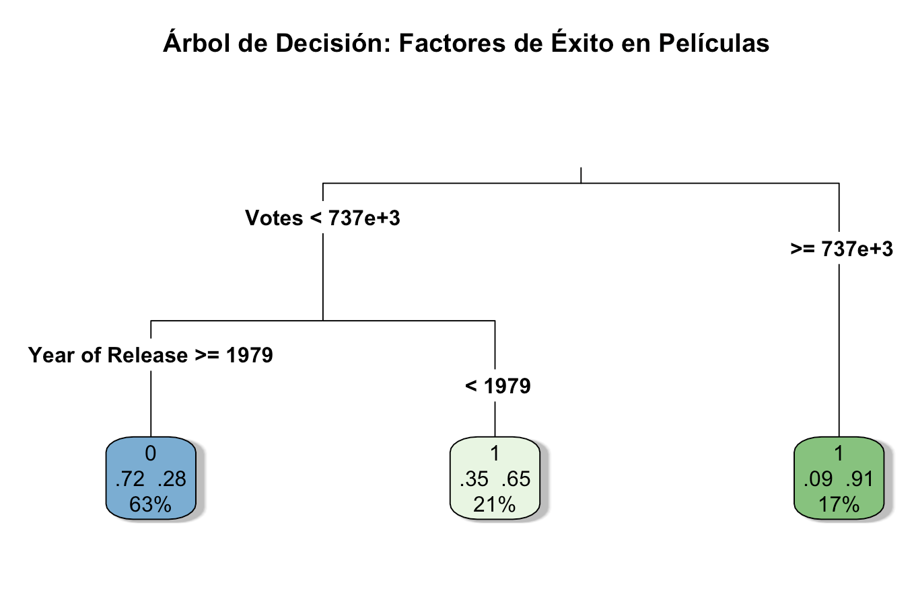

# KDD aplicado al Top 1000 de IMDb

Proyecto de la materia Metodología de la Investigación (5.º semestre, Ingeniería en Ciencia de Datos, Universidad Veracruzana). La consigna era buscar un conjunto de datos de mi elección y recorrer con él las siete fases del proceso KDD. Elegí las 1000 películas mejor calificadas de IMDb y me pregunté algo concreto: de las variables que trae el archivo, ¿cuáles sirven para predecir si una película llega a 8.0 o más?



## Los datos

El archivo `data/Top_1000_IMD.xlsx` trae 1000 películas con nombre, año, duración, calificación, Metascore, recaudación (Gross), votos y una descripción. Fuente original: [falta: enlace de la fuente del dataset].

Dos cosas del archivo me dieron trabajo:

- Los votos están guardados como texto con comas al estilo indio, así que `27,77,378` son 2,777,378 votos. Hubo que quitar las comas y convertir a número.
- 155 películas no tienen Metascore y 162 no tienen recaudación. Quité todas las filas incompletas y quedaron 756 películas, de las cuales 338 (44.7%) tienen 8.0 o más.

## El proceso, fase por fase

| Fase | Qué hice |
|---|---|
| 1. Selección | Elegí seis columnas: año, duración, Metascore, recaudación, votos y calificación. Descarté nombre y descripción porque son texto libre. |
| 2. Integración | Armé un solo `data.frame` con esas columnas. |
| 3. Limpieza | Convertí los votos a número y eliminé las filas con valores faltantes. |
| 4. Transformación | Convertí la calificación en una variable binaria, `Clase_Maestra`, que vale 1 si la película tiene 8.0 o más y 0 si no. Después quité la calificación original para que el modelo no tuviera la respuesta a la vista. |
| 5. Minería | Dividí los datos en 80% para entrenar (604 películas) y 20% para probar (152), con semilla 42. Entrené un árbol de decisión con `rpart` limitado a profundidad 3, porque quería reglas que se pudieran leer. |
| 6. Evaluación | Medí el árbol con la matriz de confusión sobre las 152 películas de prueba. |
| 7. Presentación | Dibujé el árbol con `rpart.plot` y lo interpreté. |

## Resultados

El árbol usa solo dos variables, votos y año de estreno, y termina con tres reglas:

| Regla | Probabilidad de ser 8.0 o más | Porcentaje de la muestra de entrenamiento |
|---|---|---|
| 737,000 votos o más | 91% | 17% |
| Menos de 737,000 votos y estrenada antes de 1979 | 65% | 21% |
| Menos de 737,000 votos y estrenada en 1979 o después | 28% (o sea, 72% de que no llegue) | 63% |

Importancia de las variables según el modelo: votos 50.04, año 25.20, recaudación 10.91, Metascore 5.08 y duración 0.61.

Sobre las 152 películas de prueba:

|  | Real: menos de 8.0 | Real: 8.0 o más |
|---|---|---|
| **Predicho: menos de 8.0** | 70 | 31 |
| **Predicho: 8.0 o más** | 22 | 29 |

El accuracy es 65.13%. La especificidad es 76.1% (acierta 70 de las 92 películas que no llegan a 8.0) y la sensibilidad es 48.3% (acierta 29 de las 60 que sí llegan).

## Qué opino de los resultados

El modelo es modesto. En el conjunto de prueba, 92 de las 152 películas (60.5%) están por debajo de 8.0, así que un modelo que respondiera siempre "no llega a 8.0" acertaría el 60.5% de las veces. El árbol saca 65.1%, unos cuatro puntos arriba. Además deja pasar más de la mitad de las películas que sí llegan a 8.0.

Otras limitaciones que conviene tener presentes:

- Todas las películas del archivo ya están en un top de IMDb. Lo que el árbol encontró vale para esa muestra y no necesariamente para el cine en general.
- Los votos y la calificación se alimentan entre sí: una película muy vista y bien calificada atrae más votos. El árbol describe una asociación, no dice qué causa qué.
- Usé una sola división entrenamiento/prueba. Con 152 películas de prueba, el accuracy puede moverse bastante con otra semilla. Validación cruzada sería el siguiente paso.
- Que la recaudación no aparezca en las divisiones del árbol de profundidad 3 no significa que no tenga relación con la calificación. Con más profundidad podría aparecer.

## Cómo correrlo

```bash
git clone https://github.com/<tu-usuario>/kdd-imdb-top1000.git
cd kdd-imdb-top1000
Rscript analisis_kdd.R
```

Paquetes de R necesarios: `readxl`, `dplyr`, `stringr`, `rpart`, `rpart.plot` y `caret`.

## Contenido del repositorio

```
├── analisis_kdd.R      # código completo, fase por fase
├── data/               # Top_1000_IMD.xlsx
├── images/             # árbol de decisión generado
└── reporte/            # reporte escrito en Word
```
